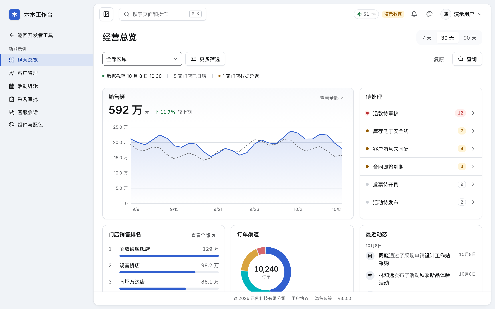
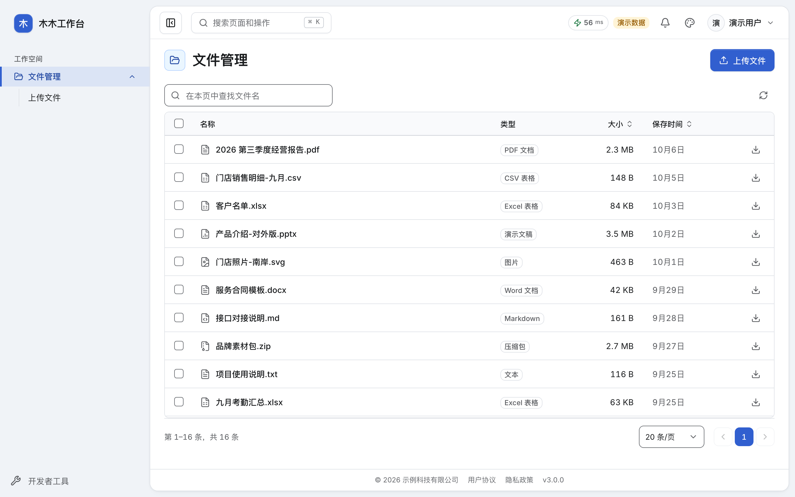
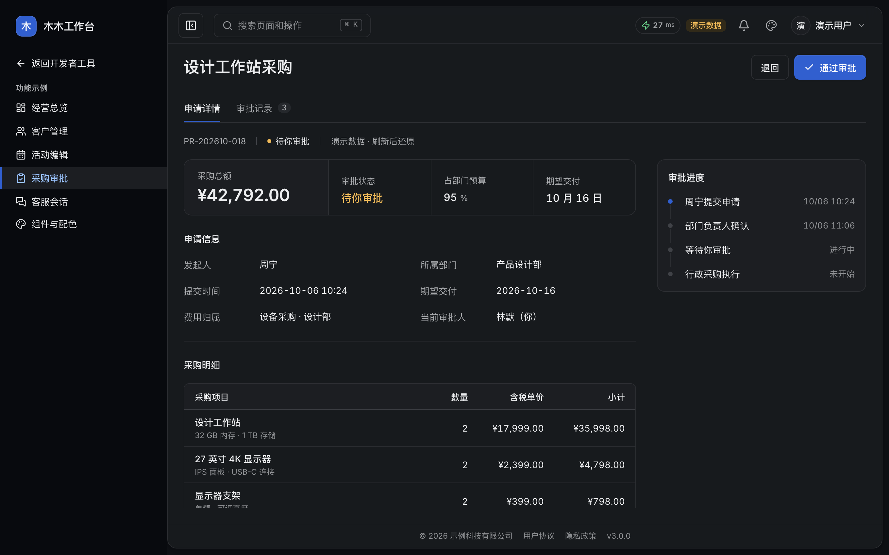
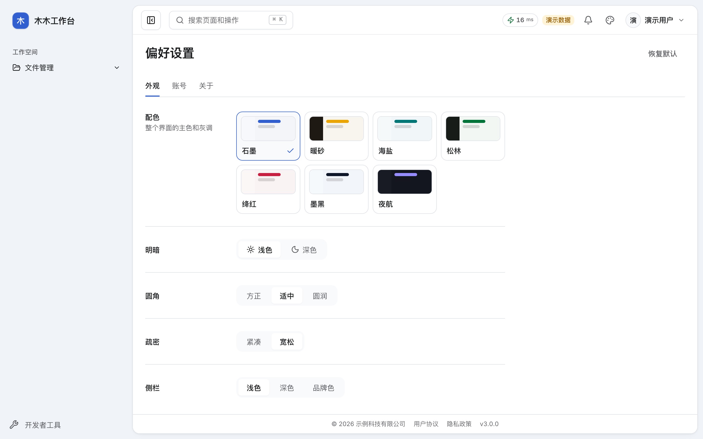
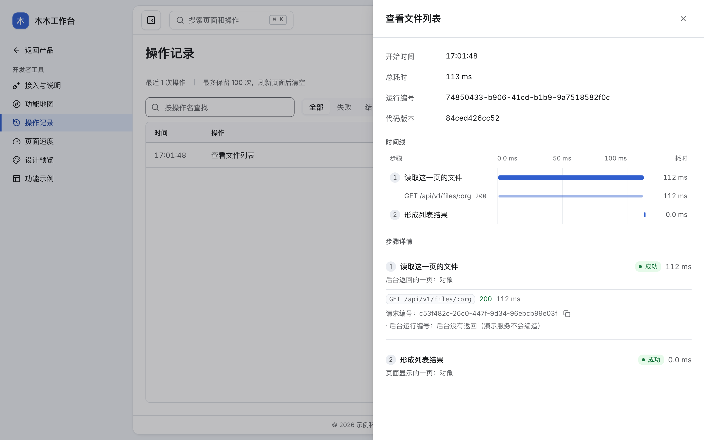
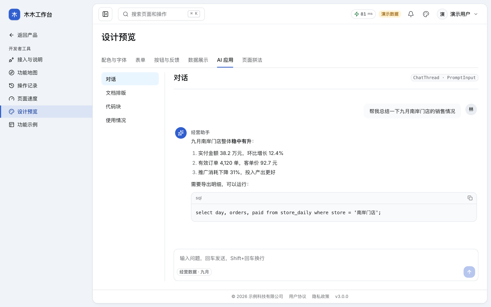

# Vue 3 Enterprise Business Frontend Template

[](CHANGELOG.md)
[](LICENSE)
[](package.json)
[](design/frontend-template.md)
[](src/shared/ui/README.md)
[](doc/formal-verification.md)
[](AGENTS.md)

[简体中文](README.md) | **English**

An enterprise-grade **Vue 3 admin and business workspace template** engineered for **Human + AI Agent collaborative development and legacy migration** (Claude Code, Codex, Cursor, Antigravity, and others). Business rules, generators, named execution steps, accessible UI components, tests, and in-browser execution traces live in deterministic locations—so humans review domain rules and visual quality while AI agents build and verify package by package.

> **Full-Stack Companion**: Connect this frontend to any HTTP API or pair it directly with **[fastapi-business-template](https://github.com/mumuxsy/fastapi-business-template)** for shared `/api/v1/access` login conventions, OpenAPI contract checks (`npm run api`), end-to-end `X-Request-ID` / `X-Run-ID` correlation, and isolated full-stack acceptance runs (`npm run test:acceptance`).

---

## Why This Template Exists

Enterprise admin frontends built under tight schedules or multi-agent code generation routinely hit four walls:

1. **Fragmented card-soup layouts**: Pages accumulate stacked cards, multiple competing primary buttons, and filler subtitles instead of a focused workspace.
2. **Tangled async state & silent write bugs**: Raw `fetch` calls inside Vue components cause stale query overwrites, duplicate write retries on network timeouts, or swallowed errors.
3. **Zero step-level visibility**: When an operation misbehaves, developers cannot tell whether validation failed, a step was skipped, or a backend request timed out.
4. **Un-upgradable starter copies**: Once shared UI and app shell files get edited alongside business modules, merging upstream improvements becomes impossible.

`vue3-business-template` solves this with **AST-checked single-task workspaces, a declarative action & step runner with TLA+-verified concurrency semantics, a custom three-layer Reka UI + Tailwind CSS 4 design system, and `framework.lock`-guarded three-way framework upgrades**.

---

## UI System & Built-in Developer Workbench

All screenshots below are captured directly from the live development server (sample modules and showcase images are automatically excluded when initializing a new product):

| Single-Workspace Executive Overview Recipe | Sample Business Module (`file_library`) |
| --- | --- |
|  |  |
| **Dark Mode Procurement Approval Recipe** | **7 Palettes, Light/Dark, Radius, Density & Sidebar Settings** |
|  |  |
| **DevTools: Waterfall Timeline & Step-Level Trace** | **Design Preview: Built-in AI Chat & Code Components** |
|  |  |

---

## Key Capabilities

### 1. Three-Layer Design System & Single-Task Layout Guardrails
- **Reka UI primitives + Tailwind CSS 4 semantic tokens**: Built without heavy third-party admin kits. Reka UI handles keyboard navigation, focus trapping, and screen-reader semantics; `@/shared/ui/public` provides high-density data tables, filter bars, forms, drawers, dialogs, charts, multi-level permission sidebars, and AI chat threads.
- **7 curated color palettes & multi-axis theming**: Switch across Graphite, Warm Sand, Sea Salt, Pine, Crimson, Ink, and Night Flight in light or dark mode, 3 border radii, compact (44px) / comfortable (48px) density, and 3 sidebar styles—with contrast verified in Playwright across presets.
- **AST-enforced workspace rules**: Every page registers a single user `task`, one primary workspace, and at most one primary button. Structure checks reject card-stacking, subtitle clutter under headings, ad-hoc CSS/classes in business pages, and raw unstyled form inputs.

### 2. Rule-Linked Step Runner & Verified Concurrency
- **Traceable rule -> step -> test links**: Business rules live in `doc/<module>/rules.md` with explicit IDs (`R-01`) and test file mappings. Every `defineStep` binds to a declared rule ID; missing rules or unmapped tests fail `npm run check`.
- **Immutable step I/O**: Zod schemas validate inputs and step fields; runtime proxies prevent steps from reading undeclared fields or mutating nested objects and arrays in place.
- **Latest-query wins, single-shot writes & explicit `unknown` outcomes**: Concurrent queries cancel superseded requests; writes never auto-retry blindly—network interruptions surface an explicit `unknown` outcome so users/agents query backend state first. Verified on demand via **TLA+ / TLC (`LatestQuery.tla` & `SubmitWrite.tla`)**.

### 3. In-Browser Developer Workbench (`/dev`)
- **Feature Map (`/dev/map`)**: Inspect registered modules, routes, action graphs, endpoints, and exact source file:line locations.
- **Execution Records (`/dev/records`)**: Inspect the last 100 in-memory action runs with waterfall timelines, step durations, redacted field summaries, HTTP status codes, `X-Request-ID`, and backend `X-Run-ID`.
- **5 Interactive Enterprise Recipes (`/dev/examples`) & Component Gallery (`/dev/design`)**: Ready-to-reference implementations for Overview, Customer Directory, Campaign Editor, Procurement Approval, and Support Inbox.

### 4. Memory-Only Session Security, Build Budgets & Three-Way Upgrades
- **Defense in depth**: Access tokens stay strictly in page memory (cleared on logout/session switch); every non-public action enforces its own permission check; standard production builds reject demo API mode (`demo.ts` is blocked from business imports) and enforce bundle budgets (`build-budget.json`).
- **Clean initialization & conflict-safe upgrades**: `npm run start:project` strips sample modules, git history, and upstream open-source files; `npm run update:framework` performs a three-way comparison against `.template/base.json` and `framework.lock`, aborting cleanly on conflicts without overwriting product modules.

---

## Quick Start

### Prerequisites
- Node.js `>= 22.12` (`22.x`, `24.x`, or `26.x`)

### 1. Explore the Template & Interactive Examples

```sh
npm ci
npm run dev
```

Open `http://127.0.0.1:5180`:
- `/` (`/files`): Sample team file management module backed by an in-memory dev mock handler.
- `/dev`: Developer workbench—Feature Map (`/dev/map`), Waterfall Records (`/dev/records`), Speed (`/dev/speed`), and Design System Preview (`/dev/design`).
- `/dev/examples`: Five interactive enterprise workspace recipes.

### 2. Initialize a Clean Product Repository

```sh
npm run start:project -- /abs/path/my-admin-web --name "Order Operations Console"
cd /abs/path/my-admin-web
npm ci
npm run docs
```

The new product starts at `0.1.0` in `VITE_API_MODE=real` mode with sample modules, demo tests, git history, and upstream `LICENSE` / community / issue template / screenshot files cleanly excluded.

### 3. Generate Modules, Pages & Steps, Then Verify

```sh
# 1. Scaffold a registered business module
npm run new:module -- orders --title "Order Management"

# 2. Scaffold a single-task page (layouts: blank | list | form | detail | overview)
npm run new:page -- orders detail --layout detail --title "Order Detail" --task "Inspect order totals, fulfillment status, and handle exceptions"

# 3. Scaffold a named step linked to a rule ID in doc/orders/rules.md
npm run new:step -- orders load_detail --action orders.prepare --rule R-00 --title "Load order detail"

# 4. Refresh generated docs, run static + unit checks, Playwright browser checks, and production build
npm run docs
npm run check
npm run test:browser
VITE_API_MODE=real npm run build
```

---

## Documentation & Governance

Primary engineering guides and the 8 built-in `.agents/skills/` workflows are written in concise Chinese to match the framework's Chinese validation diagnostics and UI copy standards:

- **Developer & Agent Entry**: [AGENTS.md](AGENTS.md)
- **Design Rationale**: [design/frontend-template.md](design/frontend-template.md)
- **UI System & Page Recipes**: [src/shared/ui/README.md](src/shared/ui/README.md) · [doc/ui-recipes.md](doc/ui-recipes.md) · [doc/ui-examples.md](doc/ui-examples.md)
- **Module Development & Delivery**: [doc/development.md](doc/development.md) · [doc/delivery.md](doc/delivery.md) · [doc/structure.md](doc/structure.md)
- **Verification, Acceptance & Deployment**: [doc/verification.md](doc/verification.md) · [doc/acceptance.md](doc/acceptance.md) · [doc/formal-verification.md](doc/formal-verification.md) · [doc/deployment.md](doc/deployment.md)
- **Community & Security**: [CONTRIBUTING.md](CONTRIBUTING.md) · [SECURITY.md](SECURITY.md) · [CODE_OF_CONDUCT.md](CODE_OF_CONDUCT.md) · [CHANGELOG.md](CHANGELOG.md)

---

## License

Released under the [MIT License](LICENSE). Downstream products created via `npm run start:project` do not inherit this `LICENSE` file by default, allowing you to choose any proprietary or open-source license for your own product.
