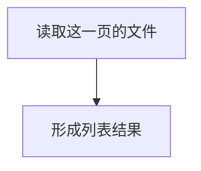
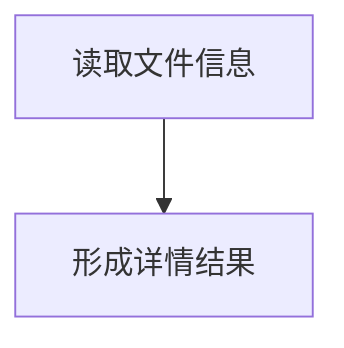
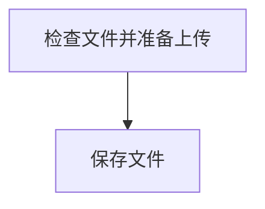

# 文件管理计算图

由实际步骤和接口生成。字段原值默认不进入运行记录。

## 查看文件列表

编号：file_library.list

| 步骤 | 读取 | 产出 | 接口 | 规则 | 函数位置 |
| --- | --- | --- | --- | --- | --- |
| 读取这一页的文件 | org、offset、limit | page | file_library.list | R-01 | src/modules/file_library/steps/read.ts:3 readPage |
| 形成列表结果 | page | result |  | R-01 | src/modules/file_library/steps/read.ts:9 presentPage |

## 查看文件详情

编号：file_library.info

| 步骤 | 读取 | 产出 | 接口 | 规则 | 函数位置 |
| --- | --- | --- | --- | --- | --- |
| 读取文件信息 | org、id | file | file_library.info | R-02 | src/modules/file_library/steps/read.ts:12 readFile |
| 形成详情结果 | file | result |  | R-02 | src/modules/file_library/steps/read.ts:17 presentFile |

## 上传文件

编号：file_library.upload

| 步骤 | 读取 | 产出 | 接口 | 规则 | 函数位置 |
| --- | --- | --- | --- | --- | --- |
| 检查文件并准备上传 | file | body |  | R-03 | src/modules/file_library/steps/write.ts:3 prepareUpload |
| 保存文件 | org、body | result | file_library.upload | R-03 | src/modules/file_library/steps/write.ts:10 uploadFile |

## 删除文件

编号：file_library.delete

| 步骤 | 读取 | 产出 | 接口 | 规则 | 函数位置 |
| --- | --- | --- | --- | --- | --- |
| 删除已确认的文件 | org、id | result | file_library.delete | R-04 | src/modules/file_library/steps/write.ts:16 deleteFile |

## 下载文件

编号：file_library.download

| 步骤 | 读取 | 产出 | 接口 | 规则 | 函数位置 |
| --- | --- | --- | --- | --- | --- |
| 读取下载内容 | org、id | result | file_library.download | R-05 | src/modules/file_library/steps/write.ts:21 downloadFile |

## 接口

| 接口 | 方法 | 路径 |
| --- | --- | --- |
| 读取文件列表 | GET | /api/v1/files/:org |
| 读取文件详情 | GET | /api/v1/files/:org/:id/info |
| 上传文件 | POST | /api/v1/files/:org |
| 删除文件 | DELETE | /api/v1/files/:org/:id |
| 下载文件 | GET | /api/v1/files/:org/:id/download |
